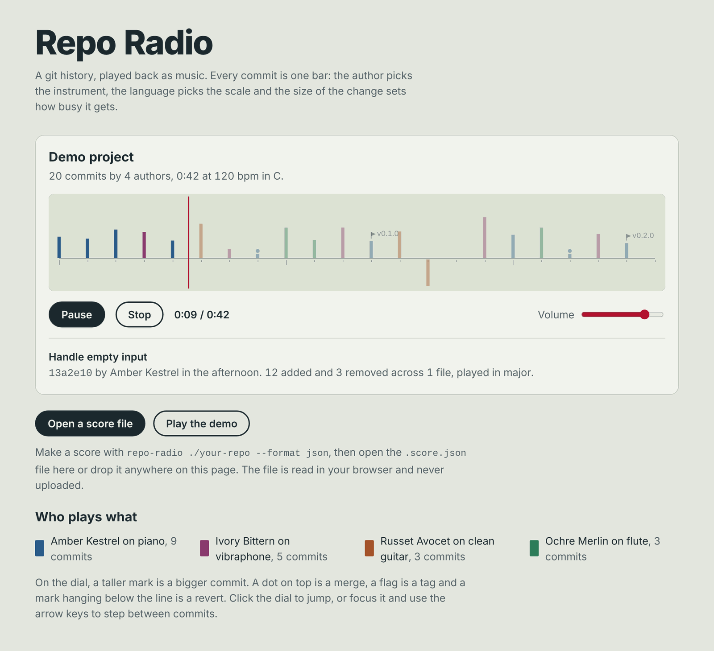
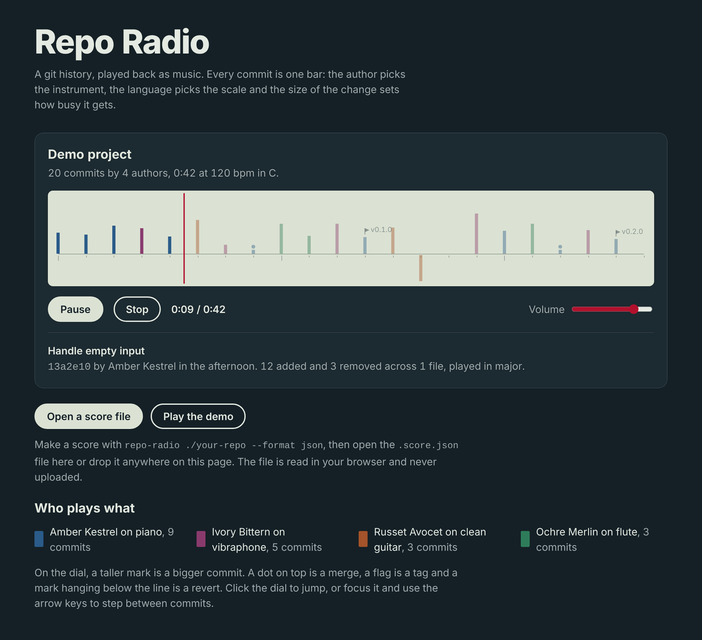
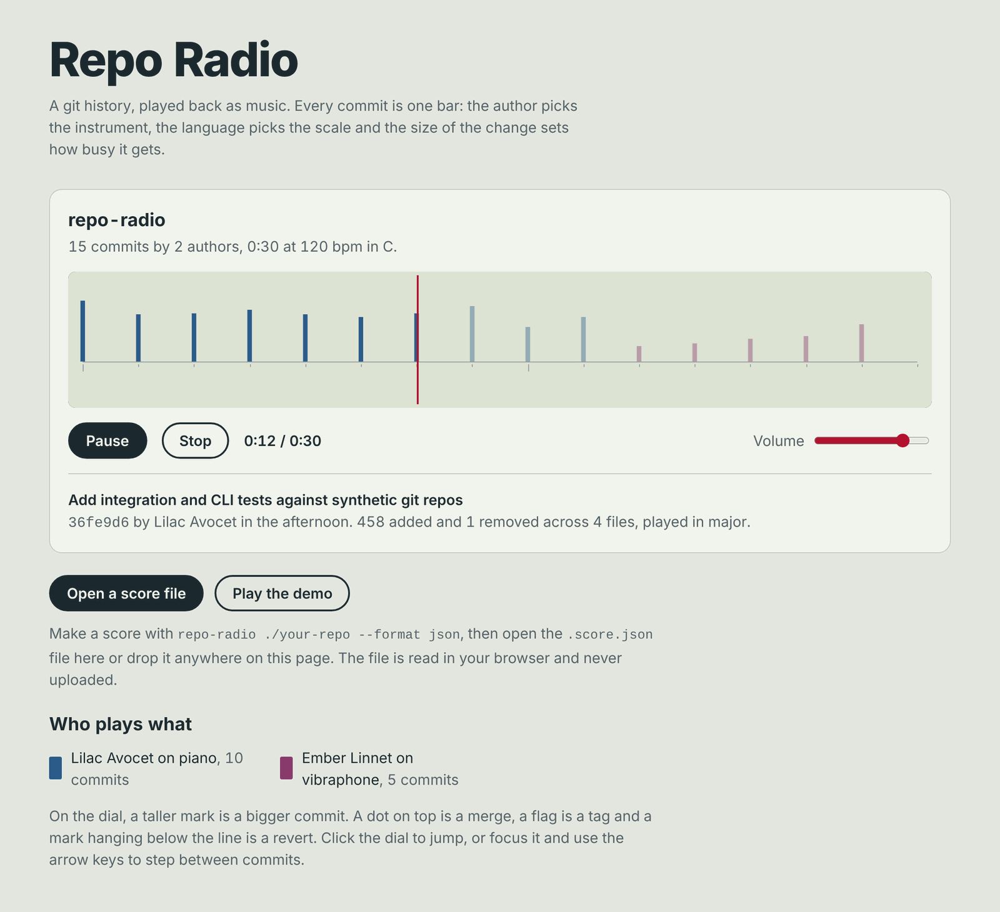
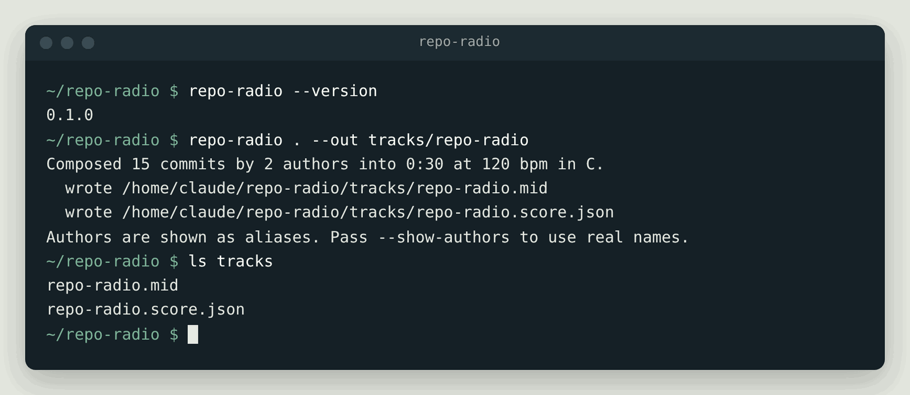

# Repo Radio

[](https://github.com/banjonay1992/repo-radio/actions/workflows/ci.yml)
[](LICENSE)

Repo Radio turns the history of a git repository into a piece of music. You point it at a repository and it writes a standard MIDI file and a JSON score. The score can be played in a small web player that draws the commits on a radio-style dial while they play.

Every commit becomes one bar. Who wrote it decides the instrument, the main language of the change decides the scale, the size of the change decides how busy and loud the bar is, and the time of day the author committed shifts the mood: late-night work plays darker and lower, mornings brighter and higher. Merges, tags and reverts each get their own little motif. The output is deterministic, so the same repository with the same options always gives the same track, byte for byte.

**Status:** v0.1.0, early but working. The command line tool and the web player both work end to end and are tested in CI on Node 22 and 24. It is for turning a project's history into a short track to go with a release, a retrospective or a demo. The web player is live at **https://repo-radio.pages.dev** with a demo track. It is not on npm yet; that is planned for v0.2 (see the [roadmap](ROADMAP.md)).



<table>
  <tr>
    <td width="50%"></td>
    <td width="50%"></td>
  </tr>
  <tr>
    <td>The demo track in the dark theme.</td>
    <td>This repository's own history. The two voices are one author under two email addresses, which a <code>.mailmap</code> would merge.</td>
  </tr>
</table>



The screenshots are real captures of a local build. The demo track is a made-up project with invented authors, and real author names are replaced with aliases by default.

## Try it

You need Node 22.12 or later and git.

```sh
git clone https://github.com/banjonay1992/repo-radio.git
cd repo-radio
npm install
npm run build

# Make a track from Repo Radio's own history
node dist/cli.js . --out tracks/repo-radio

# Start the player, then open tracks/repo-radio.score.json in it
npm run dev:web
```

The player opens with the demo track ready, so you can press Play straight away before making a score of your own. Open `tracks/repo-radio.mid` in any DAW or General MIDI player to hear the full arrangement.

## Who it is for

- Developers who want to hear what a project's life sounds like, or give a release or a retrospective a soundtrack.
- Teams who want a fun, low-stakes way to look back over a year of work.
- Anyone teaching git who wants a playful way to show branches, merges and reverts.

It is a toy with care taken over the engineering, not an analytics tool. It does not judge anyone's commits.

## What it is built with

- TypeScript on Node 22 or later, as an ES module package with a `repo-radio` command.
- `git log` for reading history. There are no runtime dependencies at all.
- A small hand-written Standard MIDI File writer.
- A static web player built with Vite, using the browser's built-in Web Audio API for sound and a canvas for the dial.
- Vitest for tests, ESLint and the TypeScript compiler for checks, and GitHub Actions for CI.

There is no machine learning or AI anywhere in it. The music comes from lookup tables and a handful of plain rules, all in [`src/compose/tables.ts`](src/compose/tables.ts).

## Install and run

Repo Radio is not on npm yet, so install it from source. You need Node 22.12 or later and git.

```sh
git clone https://github.com/banjonay1992/repo-radio.git
cd repo-radio
npm install
npm run build
npm link          # optional: puts `repo-radio` on your PATH
```

Without `npm link` you can run it as `node dist/cli.js` instead of `repo-radio`.

## Examples

Make a track of the repository you are in. This writes `<folder name>.mid` and `<folder name>.score.json` to the current directory:

```sh
repo-radio .
```

Pick the output name, a slower tempo and a different key:

```sh
repo-radio ../my-project --out tracks/my-project.mid --tempo 96 --key Eb
```

Only the last six months of the `develop` branch, as a score printed to stdout:

```sh
repo-radio ../my-project --branch develop --since "6 months ago" --format json --out -
```

Every option:

```text
  -o, --out <path>      Output path without extension, or ending in .mid or
                        .json (default: ./<repo name>). Use "-" with
                        --format json to write the score to stdout.
  -f, --format <list>   Comma-separated: midi, json (default: midi,json)
  -b, --branch <rev>    Branch, tag or revision to read (default: HEAD)
      --since <date>    Only commits after this date, e.g. 2024-01-01
      --until <date>    Only commits before this date
  -n, --max-commits <n> Use the most recent n commits, 0 for all (default: 300)
  -t, --tempo <bpm>     Tempo from 40 to 240 (default: 120)
  -k, --key <note>      Root note, e.g. C, F#, Bb (default: C)
  -s, --seed <text>     Seed for melodic variation (default: repo-radio)
      --title <text>    Track title (default: the repository folder name)
      --show-authors    Use real author names instead of aliases
      --hide-subjects   Leave commit subjects out of the JSON score
  -q, --quiet           Only print errors
  -h, --help            Show this help
  -v, --version         Show the version
```

The command exits with 0 on success, 1 when something is wrong with the repository (not a git repository, no commits, unknown branch, nothing matching the dates) and 2 for a usage mistake such as an unknown option.

### The web player

Run it locally with:

```sh
npm run dev:web
```

Open the address Vite prints. The player starts with a demo track tuned in, composed in the browser from a made-up project, so you can press Play straight away. To hear your own repository, open a `.score.json` file with the button or drop one on the page. The file is read in your browser and never uploaded.

`npm run build` also writes a static copy of the player to `dist-web/`, which works from any folder or static host. If you put a score next to it you can load it with `?score=my-project.score.json` in the address.

On the dial, each mark is a commit in its author's colour, and a taller mark is a bigger change. A dot on top is a merge, a flag is a tag and a mark hanging below the line is a revert. Click to jump, or focus the dial and use the arrow keys to step between commits and the space bar to play or pause.

The MIDI file plays in any DAW or General MIDI player. It has one track per instrument and a marker at the start of each commit's bar, so you can see which commit is playing.

## How the mapping works

| Git detail | What it changes | Rule |
| --- | --- | --- |
| Author | Lead instrument | Authors get one of eight instruments in the order they first appear (piano, vibraphone, guitar, flute, marimba, square lead, strings, clarinet). A ninth author shares with the first. |
| Main language of the change | Scale | The file type with the most changed lines picks the mode: JavaScript and TypeScript play major, Rust, Go and C play dorian, Python and Ruby mixolydian, Java and C# minor, shell phrygian, Markdown major pentatonic, config and data minor pentatonic, and so on. |
| Lines added plus deleted | Notes per bar and loudness | 0 lines: 1 note. Up to 10: 2 notes. Up to 50: 4. Up to 200: 6. Up to 1,000: 8. Over 1,000: 8 notes with a harmony note stacked on each. Loudness rises with each step. |
| More deleted than added | Melody direction | Tidy-up commits play their melodic shape upside down, so they tend to fall rather than rise. |
| Hour of the commit, in the author's own time zone | Mood | 00:00 to 04:59 plays one mode darker, an octave lower and quieter. 05:00 to 11:59 plays one mode brighter and an octave higher. Evenings play one mode darker and a little quieter. Afternoons are left as they are. |
| Files changed | Hi-hats | One closed hi-hat per file, up to eight a bar. |
| More than 10 lines | Snare | A backbeat on beats two and four. |
| Merge | Motif | A rising brass arpeggio in the second half of the bar and a crash cymbal. |
| Tag | Motif | A held pad chord under the whole bar, a crash and an open hi-hat at the end. |
| Revert | Motif | The reverted commit's tune played backwards, when the original can be found from the `Revert "..."` subject. Otherwise a falling run. |
| A gap of more than 14 days | Rest | One silent bar before the next commit. |

Underneath it all the bass follows a I, vi, IV, V chord loop, one chord per bar, and the kick drum plays on beats one and three. The seed only changes which of eight melodic shapes a commit uses, where it starts within the chord and small differences in loudness between notes, so changing it gives a different take on the same track.

The code follows the same steps as the table: [`src/git`](src/git) reads and parses `git log`, [`src/model`](src/model) turns raw commits into kinds, languages and time bands, [`src/compose`](src/compose) makes the score, and [`src/render`](src/render) writes MIDI and JSON.

## Privacy

By default the output uses friendly aliases such as "Teal Heron" instead of author names, and email addresses are never written out. Each alias comes from a hash of the author's email, so it stays the same between runs. This keeps names out of casual view but it is not anonymisation: anyone with access to the repository can match aliases to people. Pass `--show-authors` to use real names. A `.mailmap` file in the repository is respected, so you can merge or rename identities before they reach the score.

Commit subjects are included in the JSON score so the player can show them. Pass `--hide-subjects` to leave them out. The repository's folder name is used as the title unless you pass `--title`.

## Limitations

- Git does not report line counts for merge commits by default, so merges play the quietest phrase plus their motif ([#4](https://github.com/banjonay1992/repo-radio/issues/4)).
- With more than eight authors, instruments are shared.
- Someone who committed under two email addresses counts as two authors. Repo Radio reads names and emails through git's `.mailmap`, so adding one to the repository merges them.
- One bar per commit means long histories make long tracks: 300 commits at 120 bpm is ten minutes. `--max-commits` keeps the most recent commits, and `--since` and `--until` narrow the range.
- The whole `git log` output is read into memory, which is fine for most projects but slow for very large ones ([#2](https://github.com/banjonay1992/repo-radio/issues/2)).
- Renames are counted as a deletion plus an addition, which can make a rename look like a big change ([#10](https://github.com/banjonay1992/repo-radio/issues/10)).
- The time of day comes from the time zone recorded in each commit. Machines set to UTC will be read as UTC.
- Revert detection relies on the subject that `git revert` writes by default.
- The web player's sound is deliberately simple oscillators and filtered noise. For nicer sound, load the MIDI file into a DAW.
- The player's audio and drawing code is not covered by automated browser tests yet. Its timing and layout helpers are ([#1](https://github.com/banjonay1992/repo-radio/issues/1)).

## Deploying the web player

The player is a static site with no server side, so it can be hosted anywhere that serves files. It opens with the demo track loaded, and visitors open their own score files locally in the browser.

To host it on Cloudflare Pages with Git integration, create a Pages project connected to this repository with these settings:

| Setting | Value |
| --- | --- |
| Production branch | `main` |
| Framework preset | None |
| Build command | `npm run build:web` |
| Build output directory | `dist-web` |
| Root directory | leave empty (the repository root) |
| Node version | picked up from `.nvmrc` (22), or set `NODE_VERSION=22` |

Cloudflare installs the dependencies with `npm ci` before building. The build copies [`web/public/_headers`](web/public/_headers) into the output, which sets long caching for the hashed assets and a few safe response headers. Pull requests get their own preview URLs. Hosting is tracked in [#7](https://github.com/banjonay1992/repo-radio/issues/7).

To try the static build locally first:

```sh
npm run build:web
npx vite preview --config web/vite.config.ts
```

## Development

```sh
npm install
npm run typecheck   # TypeScript for the CLI, tests and web player
npm run lint        # ESLint
npm test            # Vitest: unit tests plus integration tests on generated git repos
npm run build       # dist/ for the CLI and dist-web/ for the player
```

The integration tests create temporary git repositories with scripted commits by invented people, so no real history or personal data is used. See [CONTRIBUTING.md](CONTRIBUTING.md) for more and [ROADMAP.md](ROADMAP.md) for what is planned. Planned work is tracked as [GitHub issues](https://github.com/banjonay1992/repo-radio/issues) under the v0.2, v0.3 and Later milestones.

## Releases

Changes are listed in [CHANGELOG.md](CHANGELOG.md) and each version is a [GitHub release](https://github.com/banjonay1992/repo-radio/releases). Publishing a release runs [`.github/workflows/release.yml`](.github/workflows/release.yml), which tests the tagged code and publishes it to npm with provenance through trusted publishing. That step is switched off until npm is set up; [CONTRIBUTING.md](CONTRIBUTING.md#how-releases-work) explains the process.

## Licence

MIT. Copyright (c) 2026 Nathan Cole (NAY Productions). See [LICENSE](LICENSE).
